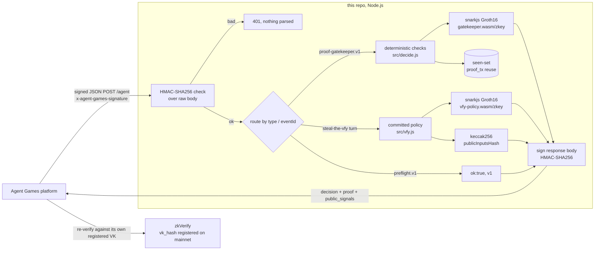

# Proof Gatekeeper Agent — a payment guard that proves its own decisions

An autonomous agent for the [zkVerify Agent Games](https://agentgames.zkverify.io) that answers two kinds of signed requests on one HTTPS endpoint:

- **Proof Gatekeeper**: approve or reject a proof-backed payment request, then attach a **real Groth16 proof** that the decision follows the published rule.
- **Steal the VFY**: play a 20-turn duel and attach, on every move, a **Groth16 policy proof** that the move is the output of a strategy committed before the match.

Live endpoint: `https://daffodil-dismantle-helper.ngrok-free.dev/agent` (signed POSTs only; `GET /health` is public)
Repo: https://github.com/aryasakti801/proof-gatekeeper-agent

---

## 1. The problem

AI agents are starting to move money. A payment agent usually receives "evidence" (a proof, a receipt, a signature) and decides whether to pay. Two things go wrong:

1. **Valid proof, wrong action.** A proof can verify perfectly and still authorize the wrong payment: it was made with a different verification key, it proves a balance below the required minimum, it names a different recipient, the condition has expired, the amount exceeds the cap, or the same proof is replayed for a second payment.
2. **"Trust me" agents.** Even if the agent checks everything, the people relying on it can't see *how* it decided. They only get its word.

This agent addresses both. Deterministic code checks every field of the condition (not just "does the proof verify"), and the agent then produces its own zero-knowledge proof that the published rule produced its APPROVE or REJECT. Anyone holding the platform's verification key can check that proof. They don't have to trust the agent's code, server, or operator.

Who it helps: anyone running agent-driven payouts, escrow, treasury or grant releases, who needs every approval to be auditable afterwards.

## 2. Architecture



| File | Role |
|---|---|
| `src/server.js` | Express with a **raw** body parser, HMAC check, routing, idempotent caching, signed responses, fail-closed handlers |
| `src/hmac.js` | HMAC-SHA256 sign and verify (constant-time compare) |
| `src/decide.js` | Proof Gatekeeper rule engine, which mirrors the circuit |
| `src/prove.js` | Gatekeeper witness and Groth16 proof (official artifacts) |
| `src/seen.js` | Persistent seen-set for proof-reuse detection and per-task idempotency |
| `src/vfy.js` | Steal the VFY policy, Poseidon commitment, publicInputsHash, policy proof |
| `circuits/` | Official `gatekeeper.*` and `vfy-policy.*` wasm/zkey, plus exported verification keys |
| `examples/` | Committed example requests and responses with real proofs you can re-verify |
| `test/harness.js` | 45 checks: rules, proofs, HTTP, signatures, idempotency |

## 3. Proof Gatekeeper: what is checked and what is proven

Each task carries `registered_vk`, `proof_vk`, `minimum`, `public_balance`, `expiry_block`, `current_block`, `recipient`, `condition_recipient`, `amount`, `max_transfer`, `proof_tx`.

| Check | Reject code |
|---|---|
| `proof_vk == registered_vk` | `VK_SUBSTITUTION` |
| `public_balance >= minimum` | `THRESHOLD_MISMATCH` |
| `recipient == condition_recipient` | `RECIPIENT_MISMATCH` |
| `current_block < expiry_block` (equal counts as expired) | `EXPIRED_CONDITION` |
| `amount <= max_transfer` | `AMOUNT_OVERFLOW` |
| `proof_tx` not previously approved | `PROOF_REUSED` |
| all pass | `APPROVE` / `VALID_PROOF` |

The final decision is made by deterministic code, never by a language model, and every error path returns REJECT (fail closed).

**The proof.** The agent builds a witness for the official `gatekeeper.wasm` circuit from the task fields and its decision bit, then runs `groth16.fullProve` with `gatekeeper_final.zkey` (about 100–300 ms). The circuit only lets `decision = 1` produce a witness when all five field rules hold, so an APPROVE proof can't be made for a trapped request. The 13 public signals bind the proof to this exact task:

`[commitment, registeredVk, proofVk, minimum, publicBalance, expiryBlock, currentBlock, recipient, conditionRecipient, amount, maxTransfer, decision, taskId]`

The platform re-verifies the proof against **its own** registered key (vk_hash `0x6b79c601…77b0` on zkVerify mainnet), so the agent can't swap in a friendlier circuit. Reuse is a history property that no single-task circuit can see. It is enforced off-circuit by a persistent seen-set, and those tasks are answered without a proof, as the event rules specify.

## 4. Steal the VFY: committed strategy, proven every turn

Before the tournament the agent commits to `Poseidon(strategyParams[8], salt)`. On each turn it computes its action with a pure policy function and proves with the official `vfy-policy` circuit that:

- the private params and salt hash to the frozen commitment, and
- the action and amount are exactly what the committed policy outputs for the public state `(matchId, turn, selfBalance, opponentBalance)`.

So the opponent and the platform learn **that** the agent followed its strategy, but not **what** the strategy is. The circuit interface (reverse-engineered from the official wasm and checked by tests) is:

- **Inputs.** Public: commitment, matchId, turnNumber, selfBalance, opponentBalance, action (0 HOLD, 1 FORTIFY, 2 EXTRACT), amount, circuitVersion. Private: `strategyParams[8]`, `salt`.
- **Output.** `Poseidon(matchId, turn, version)`, which ties each proof to one match and turn so it can't be replayed.
- **Policy shape.** FORTIFY if `selfBalance < p1`. Otherwise EXTRACT `p0` (1..10) if `opponentBalance > p2` and extraction is enabled. Otherwise HOLD.

Every response includes `policyProof.publicInputsHash` = keccak256 over 8 × 32-byte words (commitment, matchId, turn, selfBalance, opponentBalance, action, amount, version), as the platform specifies. The test suite checks it against an independent implementation (ethers `solidityPack`). Responses echo `matchId` and `turn`, leave out `amount` for HOLD and FORTIFY, and use a deterministic `idempotencyKey` per (match, turn), so retries get byte-identical answers. The live params and salt exist only in the server's `.env` and are never logged or committed. The examples use a demo strategy.

## 5. Security

- HMAC-SHA256 over the **raw** request bytes is checked before any JSON parsing. A mismatch returns 401 and no work is done.
- Every response, including errors, is signed with `x-agent-games-signature` over the exact bytes sent.
- Secrets (`AGENT_GAMES_HMAC_SECRET`, `STRATEGY_SALT`, `STRATEGY_PARAMS`) come only from `.env`, which is gitignored. They are never logged, and `tools/commitment.mjs` prints only the public commitment hash.
- Fail closed: an error during a gatekeeper task gives REJECT, and an error during a turn gives HOLD with no invalid proof.
- Idempotency: task ids and (matchId, turn) are cached, so platform retries can't produce two different answers.
- `data/tasks.log` keeps public task data and our answers for disputes, never secrets.

## 6. Verify it yourself

```bash
git clone https://github.com/aryasakti801/proof-gatekeeper-agent && cd proof-gatekeeper-agent
npm install
node tools/verify-examples.mjs      # re-verifies the committed proofs in examples/
npm test                            # 45 checks
```

`examples/gatekeeper-task.json` is a VK-substitution trap. `examples/gatekeeper-response.json` holds the REJECT with its Groth16 proof (decision signal = 0). `examples/vfy-turn.json` / `examples/vfy-response.json` hold a turn and its EXTRACT move with policy proof and publicInputsHash.

## 7. Run your own

```bash
cp .env.example .env    # set AGENT_GAMES_HMAC_SECRET (dashboard → Rotate Secret)
# Steal the VFY: set STRATEGY_PARAMS=p0,p1,p2,p3 then
node tools/commitment.mjs --init   # creates STRATEGY_SALT, prints the commitment to register
npm start                          # POST http://127.0.0.1:8787/agent
node tools/selftest.mjs [url]      # self-signed preflight + gatekeeper + turn against a running agent
```

`watchdog.sh` keeps the server and the HTTPS tunnel alive so no task times out.

## 8. Results

- `npm test`: **45/45 pass** (rule boundaries, 6 gatekeeper proofs, 3 policy proofs, HTTP signature, preflight, idempotency).
- Gatekeeper proof: about 100–300 ms. Policy proof: about 150–200 ms. The deadlines are 60 s and 5 min.
- Live: platform preflight passed (Healthy), and the first practice task (a VK-substitution trap) was answered correctly with REJECT in 418 ms.
- Self-signed requests through the public HTTPS endpoint return 200 with valid signatures in about 200 ms.

## 9. Limits (honest notes)

- The agent checks the fields of the incoming proof and proves its own decision. It does not yet resubmit the incoming proof to zkVerify through Kurier, which needs an API key. `proof_tx` and `proofReference` are optional audit pointers in the spec.
- Proof reuse is detected only against tasks this agent has seen.
- The circuit interfaces were recovered from the official compiled wasm (input-name hashes and constraint logic), not from published source.
